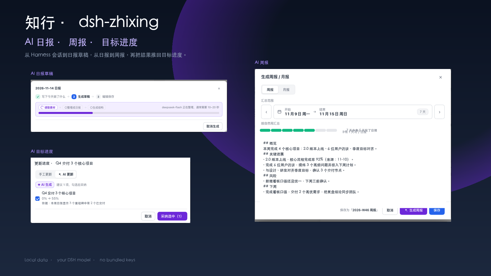
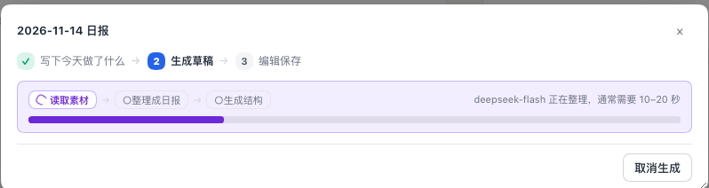
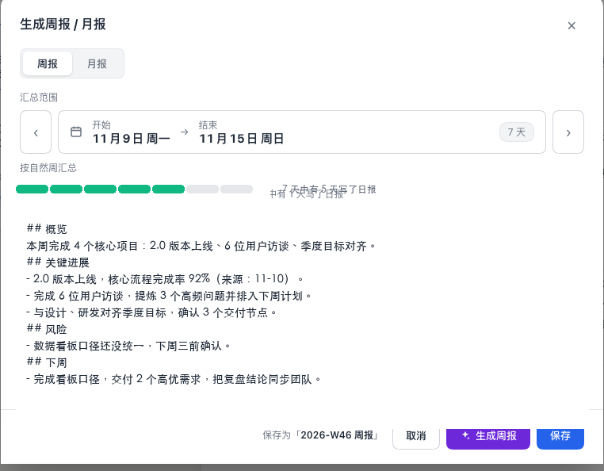
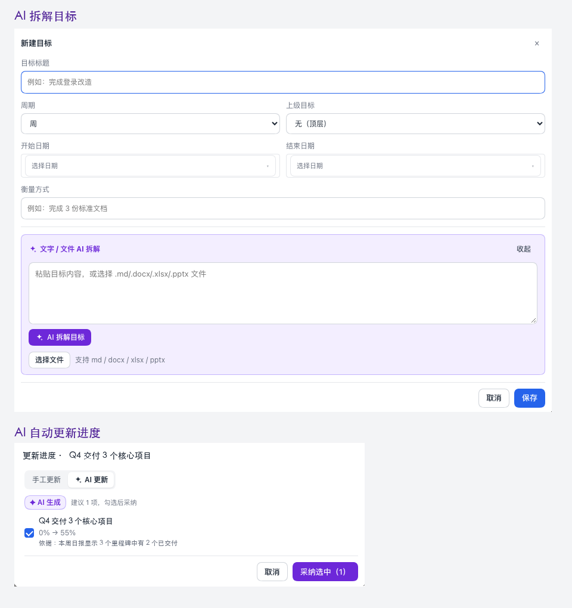
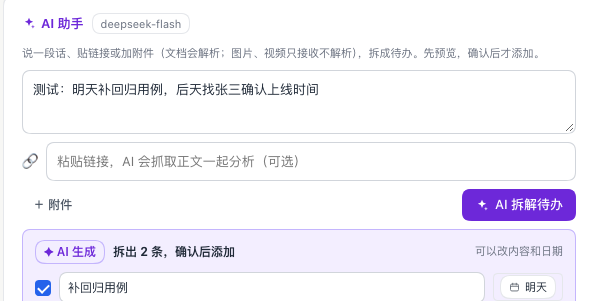
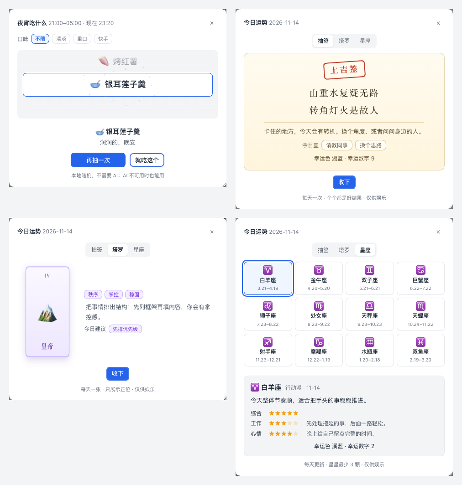

<div align="center">



# 知行 · dsh-zhixing

**AI daily reports, weekly reviews, and goal progress for DeepSeek Harness.**<br>
Work in Harness. AI drafts the daily report from your sessions, turns the week into a weekly review, and pushes the result back into tomorrow's todos and goal progress.

[简体中文](docs/lang/README_ZH.md) · [Quick start](#quick-start) · [The AI loop](#the-ai-loop) · [AI daily report](#ai-daily-report) · [AI weekly report](#ai-weekly--monthly-report) · [AI goals](#ai-goals) · [Privacy](#privacy--data)

[](https://www.npmjs.com/package/dsh-zhixing)
[](LICENSE)
[](https://github.com/pawvis/dsh-zhixing/releases)

</div>

## The AI loop

The point of 知行 is not another todo list. It is an **AI loop** around the work you already do in Harness:

| You work in Harness | AI does | You get |
| --- | --- | --- |
| Chat sessions, notes, and files | Reads the day's material, keeps the sources, and drafts a structured daily report | A daily report to edit and save |
| Save the daily report | Turns “tomorrow I will…” into tomorrow's todos, and suggests goal progress from the evidence | Tomorrow's action list + updated goals |
| Pick a week or a month | Aggregates that period's daily reports into a weekly / monthly report in your voice | A report ready to share |
| Paste a paragraph or upload a file | Splits it into year → quarter → month → week goals with measures, and later updates progress from reports | A goal tree that keeps moving |

The AI is **optional**. Without a configured model you can still write reports manually, manage todos and goals, and use the small lucky features. With a model, the loop above is the default way to work.

## AI daily report



*AI is reading the day's Harness sessions and turning them into a daily report draft.*

- The editor collects the day's Harness sessions, your notes, completed todos and attachments. Each source is listed before generation, and you can uncheck what should not be used.
- **生成日报草稿** asks the configured DSH model to write the report. The result is a normal Markdown draft you can edit; nothing is saved until you confirm.
- The same flow can run without AI: write the report manually or start from the collected material.
- Saving the report writes `日报/YYYY-MM-DD.md` and turns the “明天准备干什么” section into **tomorrow's todos**. The report also carries goal tags, so later reviews can find the relevant goals.
- After saving, AI can propose **goal progress updates** from the report's evidence; nothing changes until you accept.

## AI weekly / monthly report



*AI weekly report: pick the range, choose the audience, then edit the generated Markdown.*

- Pick a week or a month; AI reads that period's daily reports and writes the weekly / monthly summary.
- Choose the audience (**自己 / 团队 / 上级**) and generate one or more versions in a single run. Each version stays editable.
- The generated report inherits the goal tags from the period, so the weekly review and the goal tree stay connected.
- Edit inline, save as `2026-W46` / `2026-11` under `汇总/`, then copy, export to PDF / PNG / HTML, or reuse it in the next report.
- This is the “weekly review” part of the loop: daily work in, a shareable summary out.

## AI goals



*AI goal breakdown (top) and AI progress suggestions from a report (bottom). Screenshots may lag the latest UI.*

- **AI goal breakdown**: paste a paragraph, a plan, or upload a `.md` / `.docx` / `.xlsx` / `.pptx` file. AI splits it into **year → quarter → month → week** goals with a measure for each, shows a preview, and only writes `目标.json` after you confirm.
- A goal tree can be arbitrary depth: yearly goals, quarterly goals under them, monthly goals under those, and weekly goals at the leaves. Child progress automatically rolls up; leaf goals can be updated manually or from AI.
- **AI progress updates**: after a report is saved, AI reads the evidence and suggests a new progress for the leaves it can justify. Each suggestion shows the old → new percentage and the evidence; check the ones to accept, then apply.
- Goal stall reminders, list / timeline views, and linked reports make the goals part of the daily routine, not a separate spreadsheet.
- This is the “life / work goals” part: AI generates the structure once, then keeps the progress current as you report.

## AI assistant on Today



*Paste a paragraph (or a URL / attachment); AI turns it into todos you can edit and add.*

- A paragraph, a URL, or an attachment can be broken into multiple todos; preview them, adjust the dates, then add.
- Todos can be linked to goals; the calendar and the daily report share the same data.
- Morning / evening reminders and the daily quote keep the Today page useful even when you are not asking AI anything.

## The four pages

| Page | What it does |
| --- | --- |
| **今日 / Today** | Todos, calendar, AI assistant, reminders, and the two small lucky entries |
| **日报 / Reports** | AI daily / weekly / monthly reports, history, export, goal tags |
| **目标 / Goals** | AI goal breakdown, progress updates, hierarchy, timeline |
| **设置 / Settings** | Reminders, region / clock, theme, and the DSH model the plugin uses |

## A little luck

The Today banner also has two offline features: **今天吃什么** (a time-aware lunch picker) and **今日运势** (a daily sign, a tarot card, and a 12-sign horoscope). They use the built-in content and local storage only — no AI, no network. A small bonus, not the main loop.



## Quick start

1. Install DeepSeek Harness Desktop 0.2.x and make sure plugins are enabled.
2. Install the plugin:
   - **npm:** `dsh plugin --profile desktop add dsh-zhixing` (installs the latest npm version; the registry currently has 1.0.2), or
   - **from source:** clone `https://github.com/pawvis/dsh-zhixing.git` and select the cloned folder in **Plugins → Add plugin**.
3. Restart DSH and open **知行** in the sidebar.
4. Open **设置** to set reminders, region and clock. If you want AI, make sure a DSH model is configured; the model picker in the plugin header controls which one the plugin uses.
5. Try the loop: open a day's report, click **生成日报草稿**, edit, save; then open **目标** and use **文字/文件 AI 拆解** on a plan.

> The npm registry currently has `1.0.2`; `v1.1.0` is available from the GitHub release / offline zip until it is published to npm. The plugin works without AI; the AI features simply stay unavailable.

## Privacy & data

- **Local data.** Todos, goals, reports, imported files and settings live under `~/.dsh/data/知行/` (or `$DSH_HOME/data/知行/`). Reports are plain Markdown.
- **No bundled keys.** The plugin ships no API keys. AI features use the model already configured in DSH; only the content you send to an AI feature (report material, report draft, goal import, progress suggestions, assistant input) goes to that model.
- **Sources stay visible.** The report editor lists the sessions and materials used for a draft; you can uncheck them before generating.
- **Weather is optional.** The weather line makes a weather request for the configured region; turn it off in Settings. The daily quote is built in.
- **Lucky features are offline.** They use the built-in content and a few `localStorage` keys. No network, no AI.
- **No telemetry.** The plugin adds no analytics or remote logging.
- **Screenshots in this README are illustrative** and use demo content; real todo / report / goal content is never committed.

All screenshots above are captured from the plugin's UI with demo data.

## Troubleshooting

- **AI is unavailable:** the banner says “AI 暂时不可用” when no model is configured or the model is unreachable. You can still write reports manually, manage todos / goals, and use the lucky features.
- **No 知行 entry:** check DSH Desktop 0.2.x, the plugin is enabled under Plugins, and DSH was restarted after installation.
- **Where is my data?** `~/.dsh/data/知行/`: `日报/YYYY-MM-DD.md`, weekly / monthly files in `汇总/` (`2026-W46.md`, `2026-11.md`), `待办.json`, `目标.json`, `settings.json`, `state.json`, `导入/` and `log.md`.
- **A generated report looks off:** edit it before saving; the AI draft is a draft, not an automatic commit.
- **Goal progress did not change:** progress changes only after you accept a suggestion (or edit it manually); child goals then recompute automatically.
- **Updating:** replace the plugin or pull the repository and restart DSH. The data lives outside the plugin folder, so it is kept.

## Development

Requires Node.js 22.19+ for the checks; the plugin runs inside DSH.

```sh
npm run check
```

The check runs `node scripts/check-components.mjs`, `node --check index.js` and `node --check client.js`. There is no build step: DSH serves `client.js` directly, and the CSS is a template string inside the client.

```text
index.js            # plugin entry / server routes
lib/                # store, routes, AI, reports, goals, reminders, ...
client.js           # the whole web UI (React h(), CSS)
locale/             # zh / en UI strings
cordis.patch.yml    # DSH bundle manifest
icon.svg
docs/DETAIL.md      # full feature notes (Chinese)
docs/readme/        # README assets
docs/lang/          # translations
scripts/            # checks
```

Full feature notes: [docs/DETAIL.md](docs/DETAIL.md) (Chinese). Issues and ideas: [GitHub Issues](https://github.com/pawvis/dsh-zhixing/issues).

## Languages

**English** · [简体中文](docs/lang/README_ZH.md)

The plugin UI is Simplified Chinese; the Chinese README is the primary user guide.

## License

[MIT](LICENSE) © dsh-zhixing contributors
