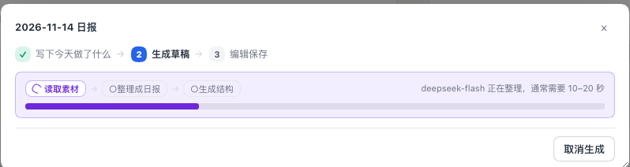
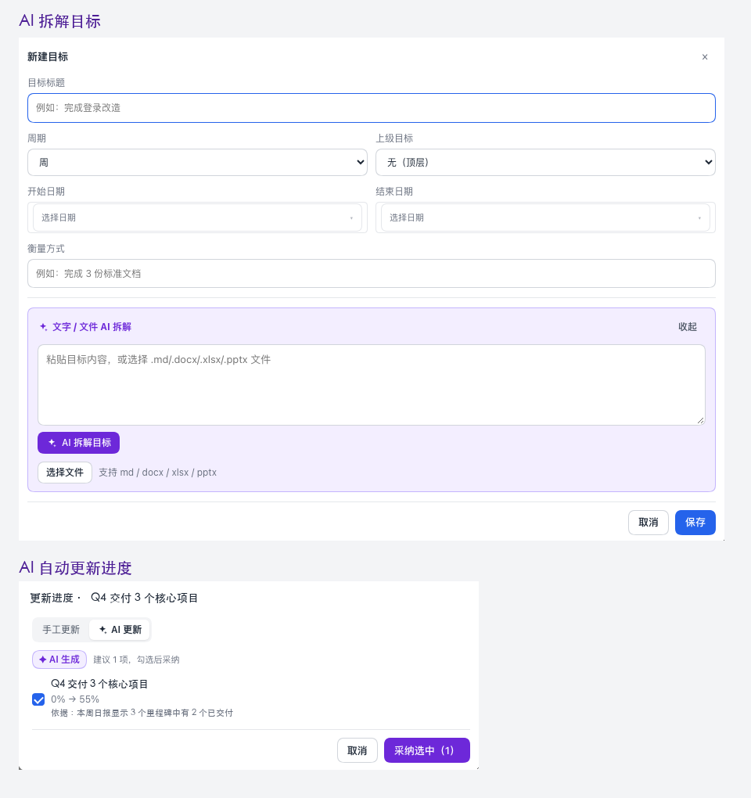
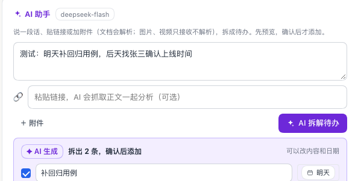
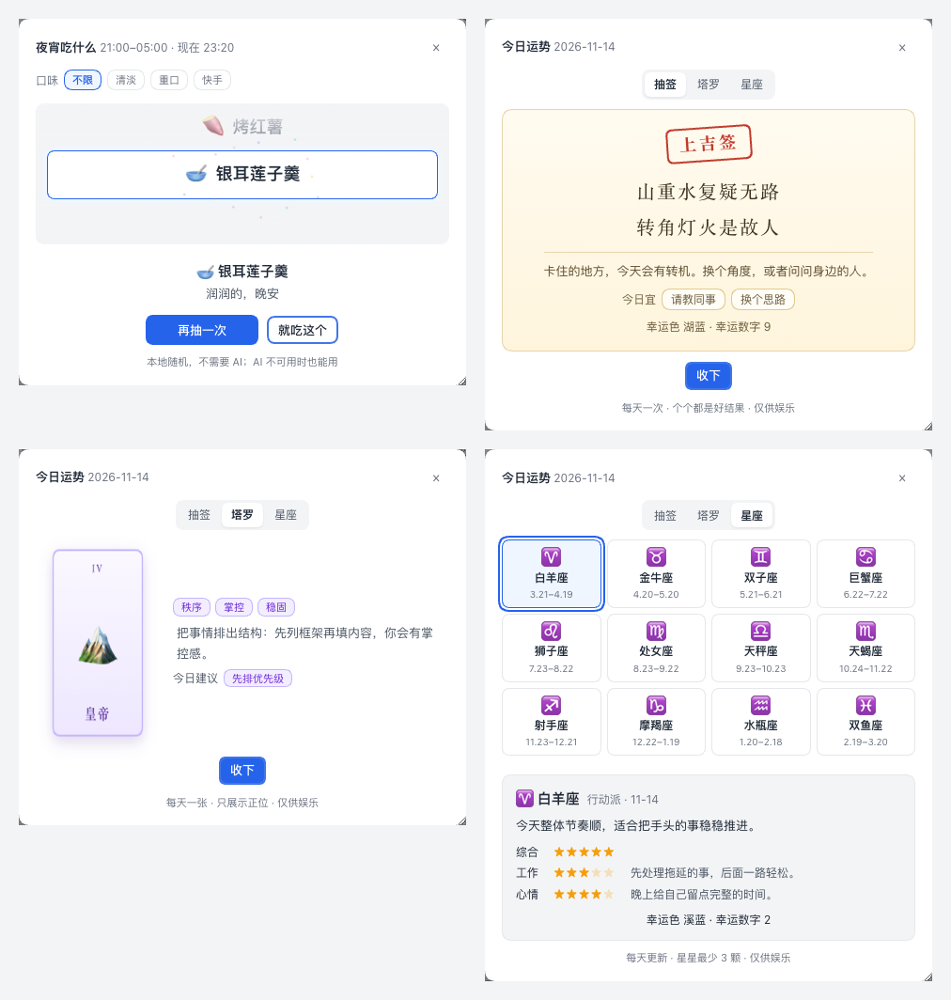

<div align="center">


# 知行 · dsh-zhixing

**AI 自动日报、周报与目标进度，为 DeepSeek Harness 而做。**<br>
在 Harness 里做事，AI 把当天整理成日报、把一周整理成周报，再把结果推回明天的待办和目标进度。

[English](../../README.md) · 简体中文 · [AI 闭环](#ai-闭环) · [AI 日报](#ai-日报) · [AI 周报](#ai-周报--月报) · [AI 目标](#ai-目标) · [快速开始](#快速开始) · [隐私与数据](#隐私与数据)

[](https://www.npmjs.com/package/dsh-zhixing)
[](../../LICENSE)
[](https://github.com/pawvis/dsh-zhixing/releases)

</div>

## AI 闭环

知行不是又一个待办列表，而是围绕你在 Harness 里已经做过的事，跑一个 **AI 闭环**：

| 你在 Harness 里 | AI 做什么 | 你得到 |
| --- | --- | --- |
| 聊天会话、笔记、文件 | 读当天材料，保留来源，生成结构化的日报草稿 | 可编辑的日报 |
| 保存日报 | 把「明天准备干什么」变成次日待办；根据证据建议目标进度 | 明天的待办 + 更新的目标 |
| 选一周 / 一个月 | 汇总这段时间的日报，写成周报 / 月报 | 可分享的周报 / 月报 |
| 粘贴一段话 / 上传文件 | 拆成年 → 季度 → 月 → 周目标，带衡量方式；之后继续从日报更新进度 | 能持续推进的目标树 |

AI 是**可选的**。不配置模型也能手动写日报、管理待办和目标、使用两个小趣味；配置模型后，上面这条闭环就是默认工作方式。

## AI 日报



*AI 正在读取当天的 Harness 会话，并整理成一份日报草稿。*

- 日报编辑器会收集当天的 Harness 会话、笔记、已完成待办和附件；生成前先列出来源，不想用的可以取消勾选。
- **生成日报草稿**让已配置的 DSH 模型来写；结果是一份普通 Markdown 草稿，可以自由修改，确认保存前不会写入。
- 同一套流程也可以不用 AI：手写，或者从采集到的素材开始。
- 保存后写入 `日报/YYYY-MM-DD.md`，并把「明天准备干什么」变成**次日待办**；日报会带上关联目标，之后的复盘能找到对应目标。
- 保存后，AI 可以根据日报里的证据给出**目标进度建议**；不采纳就不会改动任何目标。

## AI 周报 / 月报


*AI 周报：选好范围、选受众，生成后直接编辑 Markdown。*

- 选一周或一个月；AI 读取这段时间的日报，写成周报 / 月报。
- 可以选择受众（**自己 / 团队 / 上级**），一次生成一个或多个版本；每个版本都能继续编辑。
- 生成结果自动继承这段时间日报里的目标标签，让周报和目标树保持关联。
- 直接在弹窗里编辑，保存到 `汇总/` 下的 `2026-W46.md` / `2026-11.md`；之后可以复制、导出 PDF / PNG / HTML，或作为下一份报告的素材。
- 这是闭环里的「周复盘」：把每天的输入，变成一份可分享的总结。

## AI 目标



*AI 拆解目标（上）和根据日报建议目标进度（下）；截图可能落后于最新 UI。*

- **AI 拆解目标**：粘贴一段话、一个计划，或上传 `.md` / `.docx` / `.xlsx` / `.pptx` 文件；AI 拆成**年 → 季度 → 月 → 周**目标，每条都带衡量方式；标题控制在 20 字以内，具体内容放进每条的**详细说明**，过长的标题会先由 AI 自动缩写；先预览，确认后才写入 `目标.json`。
- **AI 批量更新进度**：目标页「AI 更新进度」一次性评估所有叶子目标；打开弹窗不会自动调用 AI，点「开始评估」才开始，确认「一键更新选中」后才写入，单次最多 +30%，已完成目标自动跳过。
- 目标树可以任意深度：年度目标下挂季度，季度下挂月度，月度下挂周度；有子目标时进度由子目标自动汇总，叶子目标可以手改或采纳 AI。
- **AI 自动更新进度**：保存日报后，AI 根据日报里的证据，为能判断的叶子目标给出新进度；每条建议都显示「旧 → 新」和依据，勾选后才会应用。
- 加上目标停滞提醒、列表 / 时间轴视图和关联日报，目标管理变成每天顺手做的事，而不是另一张表。
- 这是「人生 / 工作目标」那部分：AI 先帮你生成结构，之后随着你的日报，持续把进度更新到最新。

## AI 助手



*粘贴一段话（或 URL / 附件），AI 拆成可编辑的待办，确认后添加。*

- 一段话、一个 URL、一个附件，都可以拆成多条待办；先预览，改日期，再添加。
- 待办可以关联目标；日历和日报共用同一份数据。
- 早安 / 晚报提醒和每日一句，让「今日」即使不找 AI 也有用。

## 四个页面

| 页面 | 做什么 |
| --- | --- |
| **今日** | 待办、日历、AI 助手、提醒，以及两个小趣味入口 |
| **日报** | AI 日报 / 周报 / 月报，历史、导出、目标标签 |
| **目标** | AI 拆解、进度更新、层级、时间轴 |
| **设置** | 提醒、地区 / 时钟、主题，以及插件使用的 DSH 模型 |

## 一点小趣味

今日横幅还有两个本地小功能：**今天吃什么**（按时间推荐的午餐 / 夜宵选择器）和**今日运势**（每日一签、一张塔罗、12 星座）。只用插件内置内容和 `localStorage`，不调用 AI、不发网络请求。属于彩蛋，不是主闭环。



## 2.0 新增

- **今日杠杆**：每天只盯 2–4 件推动目标的事，AI 推荐、你确认；其余待办折叠为杂务。
- **北极星**：反愿景 / 一句话愿景 / 身份宣言 / 规则，只存本机、默认模糊遮挡；AI 不会代写。
- **每周偏航报告**：周日 20:00 自动统计目标证据与杠杆完成率，给出 1–3 条可采纳的调整建议；团队 / 上级周报永远不会包含这些内容。
- **今日 Boss**：今日页小按钮，看看这个月最该打的目标还剩多少血。
- **本地使用统计**：设置页可查看最近 4 周的使用数字，只有数字、没有内容。

## 快速开始

1. 安装 DeepSeek Harness Desktop 0.2.x，并确认插件功能已启用。
2. 安装插件：
   - **离线包（推荐）**：从 [Releases](https://github.com/pawvis/dsh-zhixing/releases) 下载 `dsh-zhixing-2.0.2.zip`，解压后在 **Plugins → Add plugin** 里选择解压出来的文件夹；
   - **从源码**：克隆 `https://github.com/pawvis/dsh-zhixing.git`，在 **Plugins → Add plugin** 里选择克隆下来的文件夹；
   - **npm**：`dsh plugin --profile desktop add dsh-zhixing` 也能装，但 npm 上仍是 `1.0.2`。
3. 重启 DSH，在左侧栏点 **知行**。
4. 打开 **设置**，改早晚提醒、地区和时钟。要使用 AI，先在 DSH 里配置模型；插件右上角的模型选择器决定用哪个。
5. 试一遍闭环：打开某天的日报 → **生成日报草稿** → 修改 → 保存；再去 **目标**，对一份计划用 **文字/文件 AI 拆解**。

> npm 上目前仍是 `1.0.2`；`v2.0.2` 在发布到 npm 之前，请用 GitHub Release 或离线 zip 安装。不配置 AI 也能用，只是 AI 功能会显示不可用。

## 隐私与数据

- **数据在本机**：待办、目标、日报、导入文件和设置都在 `~/.dsh/data/知行/`（或 `$DSH_HOME/data/知行/`）；日报是纯 Markdown。
- **不附带密钥**：插件不包含 API Key。AI 功能使用你在 DSH 里已经配置好的模型；只有你主动交给 AI 的内容（日报素材、日报草稿、目标导入、进度建议、AI 助手输入）会发给该模型。
- **来源可见**：日报编辑器会列出这次草稿用了哪些会话和素材；生成前可以取消勾选。
- **天气可选**：天气行会按设置里的地区发起一次天气请求；不需要可以在设置里关掉。每日一句是内置的。
- **小趣味离线**：只用内置内容和少量 `localStorage` 键，不联网、不调用 AI。
- **没有遥测**：插件没有额外加入埋点或远程日志。
- **本文截图都是演示数据**：真实待办 / 日报 / 目标内容只留在本机，不会提交到仓库。

## 常见问题

- **AI 不可用**：横幅显示「AI 暂时不可用」时，说明没有配置模型或模型不可达；手动日报、待办、目标和两个小趣味都还能用。
- **左侧栏没有「知行」**：确认 DSH Desktop 是 0.2.x、插件已在 Plugins 里启用，并且安装后重启过 DSH。
- **数据在哪**：`~/.dsh/data/知行/`；日报 `日报/YYYY-MM-DD.md`，周报 / 月报在 `汇总/` 下（如 `2026-W46.md`、`2026-11.md`），待办 `待办.json`，目标 `目标.json`，设置 `settings.json`，提醒与心跳等运行状态 `state.json`。
- **生成的日报不太对**：先改再保存；AI 草稿只是草稿，不会自动提交。
- **目标进度没变**：进度只在你采纳建议（或手动修改）后才变；之后子目标会自动重算。
- **怎么更新**：替换插件或拉取仓库后重启 DSH；数据在插件目录之外，会保留。

## 开发

需要 Node.js 22.19+ 做检查；插件本身运行在 DSH 里。

```sh
npm run check
```

检查会执行 `node scripts/check-components.mjs`、`node --check index.js` 和 `node --check client.js`。没有构建步骤：DSH 直接加载 `client.js`，CSS 是客户端里的模板字符串。

```text
index.js            # 插件入口 / 服务端路由
lib/                # store、routes、AI、日报、目标、提醒……
client.js           # 整个 Web UI（React h() + CSS）
locale/             # 中 / 英界面文案
cordis.patch.yml    # DSH bundle 清单
icon.svg
docs/DETAIL.md      # 完整功能说明
docs/readme/        # README 图片
docs/lang/          # 多语言 README
scripts/            # 检查脚本
```

完整功能说明见 [docs/DETAIL.md](../DETAIL.md)。问题 / 建议：[GitHub Issues](https://github.com/pawvis/dsh-zhixing/issues)。

## 语言

[English](../../README.md) · **简体中文**

插件界面目前是简体中文；英文 README 是给 GitHub 访客的简介，中文 README 是主要使用说明。

## 许可证

[MIT](../../LICENSE) © dsh-zhixing contributors
