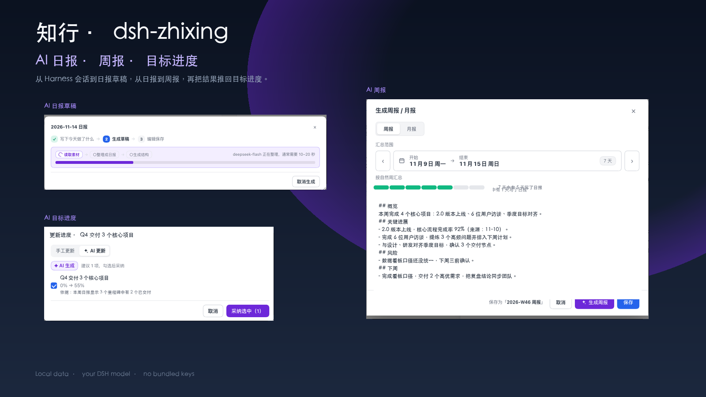

<div align="center">



# 知行 · dsh-zhixing

**把 DeepSeek Harness 里的一天整理成日报，把明天的计划变成明天的待办，再管理周月年目标。**
还有一点今日小趣味：今天吃什么，以及今日运势。

[English](../../README.md) · 简体中文 · [快速开始](#快速开始) · [一个插件，四个页面](#一个插件四个页面) · [今天吃什么与今日运势](#今天吃什么与今日运势) · [隐私与数据](#隐私与数据) · [常见问题](#常见问题)

[](https://www.npmjs.com/package/dsh-zhixing)
[](../../LICENSE)
[](https://github.com/pawvis/dsh-zhixing/releases)

</div>

## 一个插件，四个页面

| 想做什么 | 从哪里开始 | 需要什么 |
| --- | --- | --- |
| 看今天要做什么 | **今日** | 不需要；全部本地 |
| 写或回看日报 | **日报** | 可选：DSH 里已配置的模型，用于 AI 起草、周报 / 月报汇总 |
| 管理目标和进度 | **目标** | 不需要；AI 拆解可选 |
| 设置提醒、地区、时钟 | **设置** | 不需要 |

插件安装后出现在 DSH 左侧栏的 **知行**。界面是简体中文；数据全部保存在本机，所有工作区共用。

## 快速开始

1. 安装 DeepSeek Harness Desktop 0.2.x，并确认插件功能已启用。
2. 在 DSH 里打开 **Plugins → Add plugin**，输入 `dsh-zhixing` 安装。也可以走命令行：

   ```sh
   dsh plugin --profile desktop add dsh-zhixing
   ```

   想从源码安装：克隆 `https://github.com/pawvis/dsh-zhixing.git`，在 **Plugins → Add plugin** 里选择克隆下来的文件夹。
3. 重启 DSH，在左侧栏点 **知行**。
4. 打开 **设置**，按自己的作息改早晚提醒、地区和时钟。所有数据都在 `~/.dsh/data/知行/`。

## 今日

- **待办事项**：按到期时间分成「此前未完成 / 今日待办 / 之后」，可顺延、关闭；支持列表和甘特两种视图。
- **快速添加**：输入一句话回车即建；也可以关联目标、加附件，或粘贴一段话 / URL / 文档让 AI 拆成多条待办。
- **内容日历**：每格显示当天日报标题；点有日报的日期查看 / 编辑，点空白日期新建。日历和待办之间可以拖动分隔条，窄窗口会自动变成单栏。
- **AI 助手**：支持一段话、URL、附件；生成的待办预览确认后才写入。
- **提醒**：早报提醒今日待办，晚报提醒写日报；可在设置里改时间、跳过周末、设置目标停滞提醒。
- **每日一句和天气**：内置 100 条按天轮换，可自定义；天气可以按地区显示，也可以关闭。
- **今天吃什么 / 今日运势**：横幅右侧的两个小入口，详见 [今天吃什么与今日运势](#今天吃什么与今日运势)。

## 日报

- **日报 / 周报 / 月报**都是纯 Markdown，保存在 `~/.dsh/data/知行/日报/`，Obsidian 也可以直接打开和编辑。
- **从 Harness 会话采集**：选一段会话，生成可编辑草稿；补充会议、线下沟通、附件，再生成日报；确认保存后才写文件，并把「明天准备干什么」变成次日待办。
- **历史日报**：就地编辑、一键复制、导出 PDF / PNG / HTML、模板、HTML 预览、删除（二次确认）。
- **关联目标**：日报和周报 / 月报都会带上周期标签（年 / 月 / 周），支持模糊搜索和手动增补。
- **周报 / 月报**：从日报生成，可继续编辑、导出、删除，并自动继承该周期日报的关联目标。
- **AI 进度建议**：保存日报后后台分析；命中的目标出现建议卡片，点「采纳」才改进度。

## 目标

- 新建**年 / 月 / 周**目标，可挂上级：年度 → 月度 → 周，任意深度。
- 每条目标都必须写**衡量方式**，比如「完成 3 份标准文档」。
- **进度**：有子目标时由子目标平均值自动重算，不能手改；叶子目标可以手改或采纳 AI 建议。
- **视图**：列表（飞书 OKR 风格，子目标以 KR 缩进）和时间轴（按起止日期画进度条，标出今天）。
- **导入**：粘贴文字或上传文档，AI 分块拆解成标题 / 周期 / 起止 / 衡量方式 / 层级；先预览、逐条改删，确认后才写入 `目标.json`。
- **删除**：删除上级只解除子目标关联，不删除子目标，并会提示解除了几个。

## 设置

- 早安提醒 / 晚报提醒时间、是否跳过周末、目标停滞提醒天数。
- 地区、时区、24 / 12 小时制、是否显示秒、天气开关、每日一句自定义。
- 浅色 / 深色主题；插件使用的模型（范围是你在 DSH 里配置的所有模型）。

## 今天吃什么与今日运势

横幅右侧的两个小入口，全部本地运行，**不需要 AI、不需要网络**：

### 今天吃什么

- 按本机时间自动判断：早饭 05:00–10:00、午饭 10:00–14:00、下午茶 14:00–17:00、晚饭 17:00–21:00、夜宵 21:00–05:00。
- 口味筛选：不限 / 清淡 / 重口 / 快手；筛出少于 2 道时自动用全量。
- 三行滚动窗口，先快后慢约 2.6 秒；结果行弹跳 + 彩色小点；不连续抽到同一道菜。
- 「就吃这个」会关闭弹窗并弹 toast：「决定了：xxx，吃得开心～」。

### 今日运势

- **抽签**：签筒摇一摇、签升起，显示等级、签诗、解签、今日宜、幸运色 / 数字。
- **塔罗**：5 张牌背扇形，凭感觉选一张，翻面显示当天的牌（只展示正位）。
- **星座**：12 星座 4×3 网格，选中后显示综合 / 工作 / 心情三组 3–5 星评分、建议和幸运色 / 数字；下次打开自动选中上次的星座。
- 结果由本机日期决定；当天已抽的签 / 牌、选中的星座存在 `localStorage`，第二天自动可以重来。
- 尊重 `prefers-reduced-motion`：减少动态效果时直接出结果。
- 全部内容为正向文案，仅供娱乐。

## 截图

以下都是插件本机界面的示意截图；截图里隐藏了天气，真实待办和日报内容只留在本机。


*今日横幅：时钟、日期、每日一句，以及「今天吃什么 / 今日运势」。*


*今天吃什么、今日运势（抽签 / 塔罗 / 星座）。仅为示意。*

## 隐私与数据

- **数据在本机**：待办、目标、日报、导入文件和设置都在 `~/.dsh/data/知行/`（或 `$DSH_HOME/data/知行/`）。日报是纯 Markdown。
- **不附带密钥**：插件不包含 API Key。AI 功能使用你在 DSH 里已经配置好的模型；只有你主动交给 AI 的内容（日报草稿、待办拆解、目标导入、进度建议）会发给该模型。
- **天气可选**：天气行会按设置里的地区发起一次天气请求；不想要可以在设置里关掉。每日一句是内置的。
- **小趣味离线**：今天吃什么 / 今日运势使用插件内置内容；只把当天是否已抽、选中的星座写进 `localStorage`，不发网络请求、不调用 AI。
- **界面状态**：主题、分隔条宽度、抽签标记等放在浏览器本地存储，不同步到服务器。
- **没有遥测**：插件没有额外加入埋点或远程日志；DSH 宿主本身的设置另算。

### 数据目录

```text
$DSH_HOME/data/知行/
├── 日报/YYYY-MM-DD.md     # 日报；周报 / 月报也在此目录（如 2026-W46.md / 2026-11.md）
├── 待办.json
├── 目标.json
├── 导入/<日期>/           # 原始文件，只读
├── log.md                 # 时间 | 动作 | 结果
├── 待办与目标总览.md      # 只读镜像
├── settings.json
└── 状态.json
```

## 常见问题

- **左侧栏没有「知行」**：确认 DSH Desktop 是 0.2.x、插件已在 Plugins 里启用，并且安装后重启过 DSH。
- **AI 功能不可用**：横幅出现「AI 暂时不可用」时，说明没有配置模型或模型不可达；待办、目标、手动日报和两个小趣味仍然可用。
- **数据在哪**：`~/.dsh/data/知行/`；日报是 `日报/YYYY-MM-DD.md`，待办 `待办.json`，目标 `目标.json`，设置 `settings.json`。
- **天气不对**：在设置里改地区；不需要就在设置里关掉。
- **怎么更新**：拉取仓库或替换插件文件夹后重启 DSH；数据在插件目录之外，会保留。
- **想清空重来**：先备份 `~/.dsh/data/知行/`；删掉后插件会重新建目录。

## 开发

需要 Node.js 22.19+ 做检查；插件本身运行在 DSH 里。

```sh
npm run check
```

检查会执行 `node scripts/check-components.mjs`、`node --check index.js` 和 `node --check client.js`。没有构建步骤：DSH 直接加载 `client.js`，CSS 是客户端里的模板字符串。

```text
index.js            # 插件入口 / 服务端路由
lib/                # store、routes、AI、日报、目标、提醒……
client.js           # 整个 Web UI（React h() + CSS）
locale/             # 中 / 英界面文案
cordis.patch.yml    # DSH bundle 清单
icon.svg
docs/DETAIL.md      # 完整功能说明
docs/readme/        # README 图片
docs/lang/          # 多语言 README
scripts/            # 检查脚本
```

完整功能说明见 [docs/DETAIL.md](../DETAIL.md)。问题 / 建议：[GitHub Issues](https://github.com/pawvis/dsh-zhixing/issues)。

npm 包已发布为 `dsh-zhixing`。维护者修改 `package.json` 里的版本号后，在本目录执行 `npm publish` 即可。

## 语言

[English](../../README.md) · **简体中文**

插件界面目前是简体中文；英文 README 是给 GitHub 访客的简介，中文 README 是主要使用说明。

## 许可证

[MIT](../../LICENSE) © dsh-zhixing contributors
